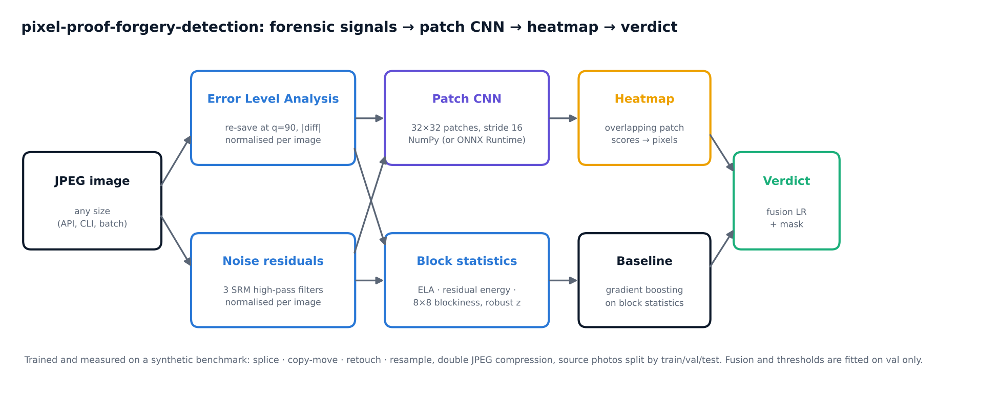
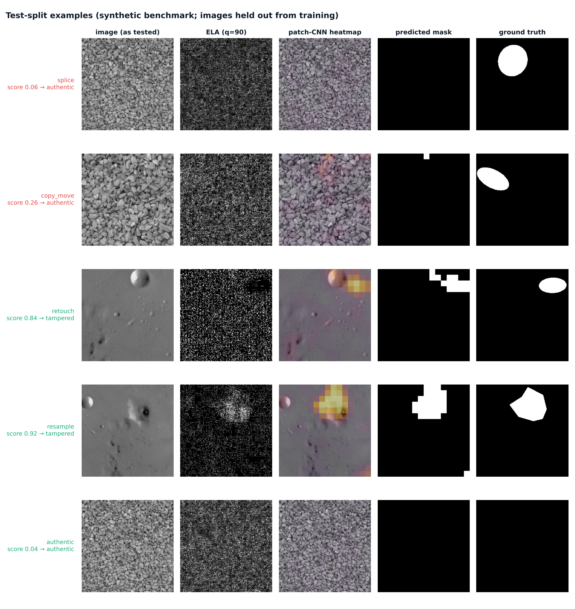
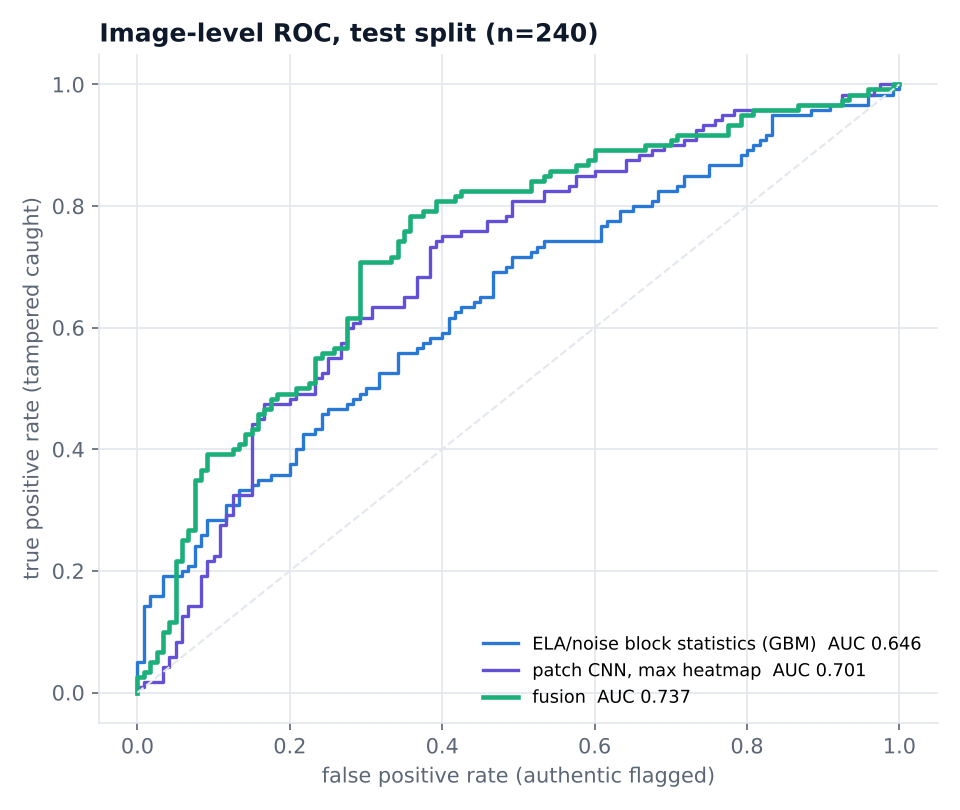
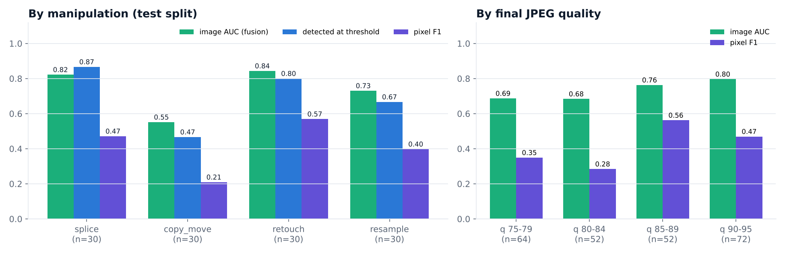
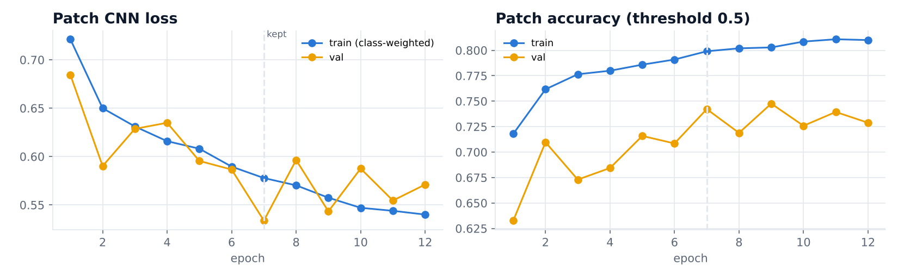

# PixelProof: Image Forgery Detection

[](https://github.com/vishavjit-singh/pixel-proof-forgery-detection/actions/workflows/ci.yml)


PixelProof decides whether a JPEG was edited and **where**. It combines classic image-forensics signals with a patch-level convolutional network:

- **Error Level Analysis (ELA)**: re-save the image and see which regions recompress differently
- **SRM-style noise residuals**: the camera-noise "fingerprint" that pasting, smoothing and resampling disturb
- **JPEG 8×8 grid cues**

A small CNN scores 32×32 patches into a tamper **heatmap**. A fusion classifier turns the heatmap and block statistics into a verdict, and the heatmap is thresholded into a mask.

Everything is trained and measured on a **reproducible synthetic benchmark** (splice, copy-move, retouch, resample, with double JPEG compression). Standard forgery datasets can't be downloaded in the environment this was built in, so the README reports only what the code measured on that benchmark.



## Why this project

| Problem | How PixelProof handles it |
|---|---|
| "Is this image edited?" is not enough for a reviewer: they need to see *where* | Patch scores are averaged into a pixel **heatmap** and thresholded into a **mask**. The API returns both, plus a PNG overlay |
| Single tricks are brittle: ELA alone fails on low-quality re-saves, noise alone on textured scenes | Three complementary signals as CNN input channels: ELA, three SRM high-pass residuals, and **local-contrast maps** (local noise, ELA and JPEG-grid energy relative to the image's own median) |
| Every JPEG online has been re-saved, so "double compression detected" is not evidence of editing | In the benchmark **authentic images are re-compressed too**, so the models have to find *local* inconsistencies, not global ones |
| Detectors overfit to the photos they were trained on | Source photos are **split by source** across train/val/test. The test split uses photos and procedural seeds the models never saw |
| Thresholds tuned on the test set flatter the numbers | The CNN trains on *train*. The fusion classifier and both thresholds are fitted on *val* (image threshold from out-of-fold scores). Only *test* is reported |
| Deep-learning frameworks are heavy to deploy | The patch CNN is about 16k parameters and runs in **NumPy**. A PyTorch twin exports to **ONNX** and runs through ONNX Runtime behind the same interface |

## Results (synthetic benchmark, held-out test split)

`make demo` builds the benchmark from 420 base images (840 JPEGs with ground-truth masks), trains everything and evaluates on the **240 test images** (120 authentic, 120 tampered, 30 per manipulation). All numbers below come from that run (`data/eval/metrics.json`).

**Examples from the test split**, including misses. The spliced and copy-moved gravel go undetected: the tampered region has the same texture and similar noise, the classic hard case.







| Metric (test split, n = 240) | Value |
|---|---|
| Image-level ROC-AUC | **0.737** fusion · 0.701 patch CNN (max of heatmap) · 0.646 ELA/noise block statistics alone |
| Accuracy at the val-chosen threshold | 0.704 (catches 70.0% of tampered images, flags 29.2% of authentic ones) |
| Localisation on tampered images | pixel F1 **0.412**, IoU 0.304 |
| Area wrongly marked on authentic images | 8.8% on average |
| By manipulation (fusion AUC / pixel F1) | splice 0.82 / 0.47 · retouch 0.84 / 0.57 · resample 0.73 / 0.40 · copy-move **0.55** / 0.21 |
| By final JPEG quality (AUC) | q75–79 0.69 · q80–84 0.68 · q85–89 0.76 · q90–95 0.80 |
| Patch CNN training set | 10,092 patches (3,692 tampered) from 400 train images; val 5,012 patches |

How to read this:

- **Copy-move is close to chance.** A region cloned from the same photo carries the same noise and compression history, so noise- and ELA-based detectors can't see it. The usual remedy is a separate keypoint or block-matching detector (see roadmap).
- **Lower final JPEG quality wipes out evidence.** AUC drops from 0.80 at q90–95 to about 0.68 at q75–84.
- These are results on a **synthetic** benchmark. Performance on real forgery datasets (CASIA, Columbia, Coverage) has **not** been measured, and real-world numbers would be expected to differ.



## The benchmark

| | |
|---|---|
| Authentic sources | scikit-image sample photos that contain **no people** (brick, cat, cells, grass, Hubble field, IHC, retina, clock, coins, coffee, gravel, moon, rocket), plus procedurally generated scenes |
| Camera simulation | random crop and resize to 256×256, sensor noise σ 1–4, first JPEG at q 70–95 |
| Manipulations | **splice** (region from another image with its own noise and compression) · **copy-move** (clone within the image) · **retouch** (inpainting or heavy smoothing) · **resample** (scale ×0.7–1.5 and rotate ±8° in place). Feathered edges, 3–14% of the image |
| Final save | every image, authentic or tampered, re-saved as JPEG at q 75–95 |
| Splits | train 200 · val 100 · test 120 base images (each gives one authentic and one tampered JPEG), with disjoint source photos per split |

Everything is generated from [`config/benchmark.yaml`](config/benchmark.yaml) with a fixed seed. Images are byte-for-byte reproducible (tested).

## Quickstart

```bash
git clone https://github.com/vishavjit-singh/pixel-proof-forgery-detection.git
cd pixel-proof-forgery-detection
python -m venv .venv && source .venv/bin/activate
make install
make demo      # generate → train (NumPy CNN) → evaluate → charts; about 8 minutes on 2 CPU cores
make test      # 24 tests, about 1 minute
```

## Usage

### CLI

```bash
python -m pixelproof generate                          # synthetic benchmark → data/benchmark
python -m pixelproof train                             # NumPy patch CNN + classifiers → models/
python -m pixelproof evaluate                          # test split → data/eval/metrics.json
python -m pixelproof analyze photo.jpg --heatmap out.png
python -m pixelproof report                            # README charts
python -m pixelproof serve --port 8000
```

`analyze` on `test-0003-t.jpg` from the test split (a resampled region, true area 9.4%) prints:

```json
{"verdict": "tampered", "score": 0.9238, "threshold": 0.597222629918162, "baseline_score": 0.7641,
 "max_patch_score": 0.9956, "suspicious_area": 0.1133, "elapsed_ms": 267.7}
```

### HTTP API

```bash
curl -s -X POST localhost:8000/v1/analyze -H "Content-Type: image/jpeg" --data-binary @photo.jpg
curl -s -X POST localhost:8000/v1/analyze -F file=@photo.jpg          # multipart works too
```

The response is the same JSON as above, plus `width`, `height` and `heatmap_png_base64` (an overlay, skip it with `?heatmap=false`). Limits: 10 MB and 4096 px per side. Non-images get `415`/`422`.

The API is built on **Starlette** (FastAPI is built on top of it). FastAPI could not be installed in the environment this was developed in, and the handlers port one-to-one.

### PyTorch → ONNX (optional)

```bash
python -m pixelproof train                                            # also writes data/patches.npz
python tools/train_torch.py --patches data/patches.npz --out models/patch_cnn.onnx
python -m pixelproof train --patch-model onnx:models/patch_cnn.onnx --models models_onnx --export-patches ""
python -m pixelproof evaluate --models models_onnx --patch-model onnx:models/patch_cnn.onnx
```

[`tools/train_torch.py`](tools/train_torch.py) defines the same network in PyTorch, and the [`PyTorch → ONNX`](.github/workflows/torch.yml) workflow runs these steps in GitHub Actions. **That path has not been run yet:** PyTorch was not installable where this was built, so its first execution is the workflow's first run. The ONNX wrapper's interface is unit-tested with a stub session.

### Docker

```bash
docker build -t pixelproof .       # trains on the synthetic benchmark during the build
docker run -p 8000:8000 pixelproof
```

## Project structure

```
├── config/benchmark.yaml        # benchmark, patch and training settings
├── src/pixelproof/
│   ├── sources.py               # people-free source photos + procedural scenes
│   ├── manipulate.py            # splice · copy-move · retouch · resample (with masks)
│   ├── benchmark.py             # camera simulation, double compression, splits, manifest
│   ├── features.py              # ELA, SRM residuals, blockiness, contrast maps, block statistics
│   ├── cnn.py                   # NumPy CNN (forward/backward/Adam) + ONNX Runtime wrapper
│   ├── detector.py              # patches → heatmap → mask; Detector save/load/analyze
│   ├── pipeline.py              # train (train/val discipline) and evaluate (test)
│   ├── api.py · cli.py · render.py · report.py
├── tools/train_torch.py         # optional PyTorch twin + ONNX export
├── tests/                       # 24 tests
└── .github/workflows/           # ci.yml (lint, tests, demo, docker) · torch.yml (optional)
```

## Testing

```bash
make lint && make test
```

- **Benchmark:** byte-identical regeneration, balanced labels and manipulations, mask areas, splits never sharing a source photo, no people in the source list, and edits that stay inside the mask (only feathering spills)
- **Features:** ELA lights up a region with a different compression history, residuals drop on a smoothed region, plus tensor shape and normalisation
- **CNN:** analytic gradients match finite differences for every parameter tensor, it learns a toy texture task, saved and loaded models give identical outputs, and the ONNX wrapper batches correctly
- **Detector:** patch grid edge coverage, overlap averaging in the heatmap, small-image padding and pixel F1/IoU
- **End to end:** train on a small benchmark, evaluate on held-out sources (better than chance), load and analyse, and every API path including 413/415/422

## Limitations and roadmap

- **Synthetic data only.** The next step is evaluation on CASIA v2, Columbia and Coverage, which needs those datasets and their licences.
- **Copy-move needs its own detector.** Noise and ELA cues don't separate a clone from its source. Keypoint matching (SIFT/ORB + RANSAC) or dense block matching would cover it.
- The NumPy CNN is deliberately small (about 16k parameters, 12 epochs on CPU). A larger PyTorch model trained on real data is where accuracy would come from. The ONNX path is in place for it.
- Not covered: AI-generated or fully synthetic images, non-JPEG pipelines, and edits followed by heavy downscaling.

## Author

**Vishavjit Singh Saini**, Data Engineer
[Portfolio](https://vishavjit-singh.pages.dev/) · [LinkedIn](https://www.linkedin.com/in/vishavjit-singh-7011211ab/) · [GitHub](https://github.com/vishavjit-singh)

## License

[MIT](LICENSE)
